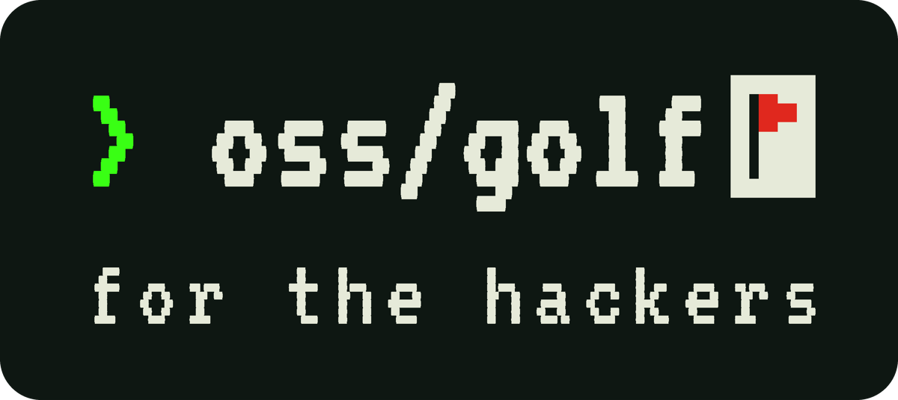
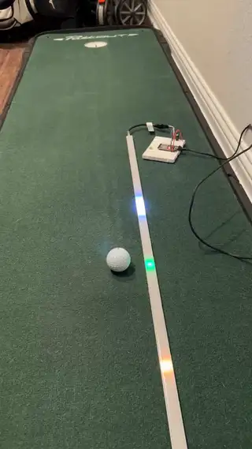
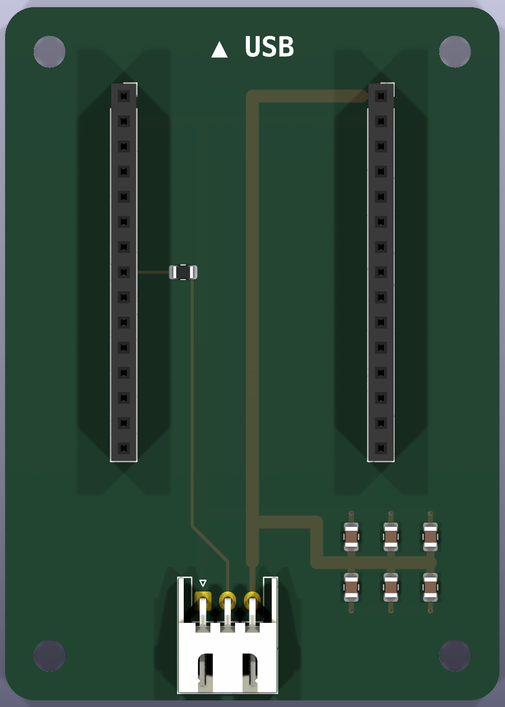
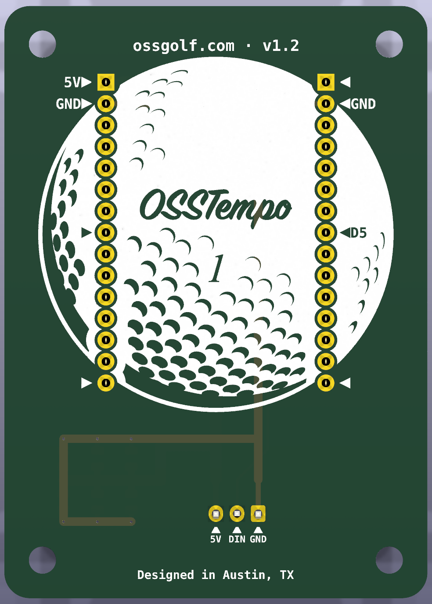
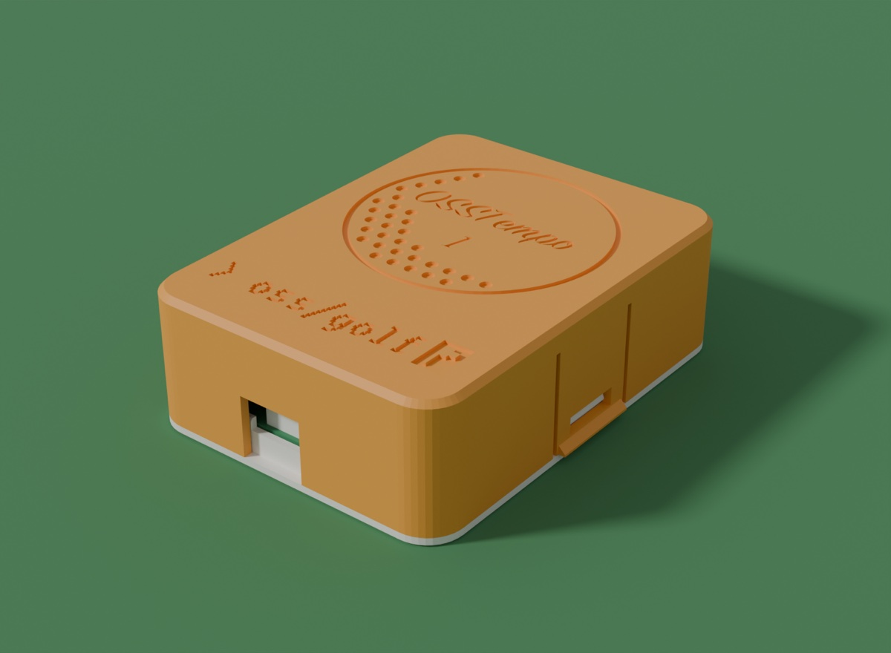
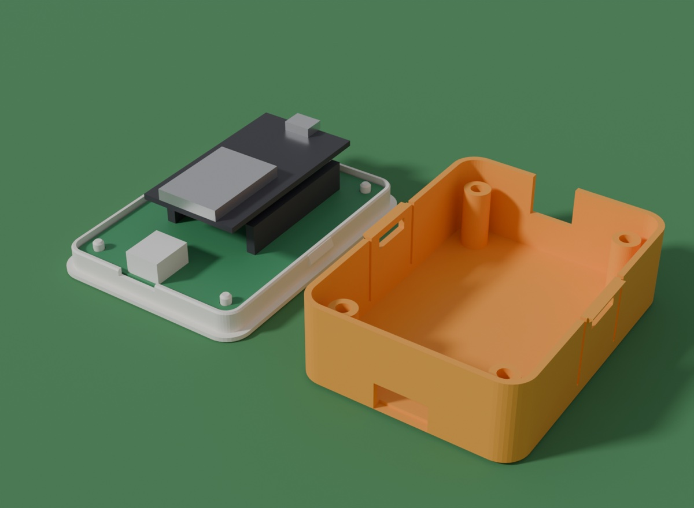

<p align="center">
  <a href="https://ossgolf.com"></a>
</p>

# OSSTempo

A golf tempo trainer you build yourself: an ESP32, an LED strip, and a dot of light
that paces your stroke.

Part of [OSSGolf](https://ossgolf.com), open source golf projects.

<p align="center">
  <a href="https://ossgolf.com/media/osstempo-putting.mp4"></a>
</p>
<p align="center"><sub>The stick pacing real putts on a practice mat. Click for the <a href="https://ossgolf.com/media/osstempo-putting.mp4">video with sound</a>.</sub></p>

<p align="center">
  
  
</p>
<p align="center"><sub>Carrier PCB v1.2, the current board: fabricated, hand-soldered and bench-tested. Details in <a href="pcb/README.md">pcb/</a>.</sub></p>

<p align="center">
  
  
</p>
<p align="center"><sub>Snap-shut printed case for the v1.2 board: the board sits on four pegs through its mounting holes and the lid clips on by hand. Files in <a href="print/pcb_case/">print/pcb_case/</a>.</sub></p>

## Goal

A white LED "comet" sweeps along the strip following a pendulum/arc model so the
motion feels like a real stroke. The user matches their club/putter head to the
dot to train tempo and stroke length. Reference dots (green = ball/impact,
amber = top of backswing, red = full extent, optional purple = full-swing
weight-shift aim) orient the golfer before each rep.

- **Putt mode:** comet sweeps center → amber (backswing), eases to a stop, then
  accelerates back through center (impact) and out the far side (follow-through).
- **Full mode:** models a full swing's *arc projected onto the 1D strip* (see
  [Animation models](#animation-models)). Lets a 1 m strip represent a swing that
  goes back and up behind the golfer.

## Build guides

Two ways to build it, same firmware and app. See [`docs/`](docs/):

- [**docs/full-diy/**](docs/full-diy/) - bare ESP32 dev board, strip, one resistor
  and one cap on a breadboard. Lowest cost.
- [**docs/dig2go/**](docs/dig2go/) - pre-assembled [QuinLED-Dig2go]. Screw in three
  wires, flash, done.
- [**pcb/**](pcb/README.md) - the ESP32 carrier PCB (v1.2): the dev board drops into two
  sockets, JLCPCB places the passives, you hand-solder eleven marked pins. Renders, build
  pipeline and the JLCPCB order files live there; [`pcb_build_spec.md`](pcb_build_spec.md)
  is the board spec.
- [**print/alignment_jig/**](print/alignment_jig/) - a 3D-printed jig that holds two sticks
  parallel, 8 in apart. Includes a Bambu Studio project for the A1 mini.
- [**print/pcb_case/**](print/pcb_case/) - a 3D-printed case for the v1.2 carrier board that
  snaps shut by hand, with openings for the USB and strip cables. Includes a Bambu Studio
  project for the A1 mini.

Each folder has a bill of materials, a wiring and flashing guide, and a pinned,
ready-to-flash sketch. The sections below are the full hardware and firmware spec
that both builds share.

[QuinLED-Dig2go]: https://quinled.info/quinled-dig2go/

## Hardware

- **MCU:** ESP32 classic (ESP-WROOM-32, 30-pin dev board, micro-USB). Uses BLE.
  USB-UART chip is a **CP2102** (Silicon Labs).
- **LED strip:** WS2812B, **144 LEDs on a ~1 m strip (144 LEDs/m)**, bare PCB
  12 mm wide x 2.2 mm tall, 5 V. (~0.69 cm per LED; half-strip ≈ 50 cm each side.)
- **Mounting:** 12 mm aluminum LED channel with frosted diffuser (self-sourced).
  The channel fits the 12 mm strip and its frosted cover blends the LEDs into a smooth dot.
- **Power:** micro-USB from a power bank or 5 V wall adapter. **A 2 A supply is
  recommended.** The strip is powered through the board's 5 V passthrough pin.
  The comet animation is low-draw (~100-300 mA). An all-LEDs-on white pattern
  draws up to ~8 A and needs a supply sized for it.
- **Protoboard:** the 30-pin ESP32 straddles **two breadboards** (one row of pins
  on each), which keeps the outer holes free.

## Wiring

| From | To |
|---|---|
| `GPIO5` (labeled `D5`) | 470 ohm resistor -> strip DIN |
| `VIN` pin (the 5 V passthrough) | strip 5V (+ breadboard red rail) |
| `GND` | strip GND (common ground, blue rail) |
| 1000 uF cap | across 5V/GND at strip input (stripe / short leg to GND) |

- **`VIN` is the 5 V passthrough.** On the 30-pin board the silkscreen labels the
  5 V pin `VIN`; it carries USB 5 V out to the strip.
- **A level shifter (SN74HCT245) is optional** — the bare 3.3 V data line drives
  the strip cleanly. Add one on the `GPIO5 -> DIN` line if flicker or wrong colors
  ever appear.
- `GPIO5` was chosen as an exposed pin on the 30-pin board. Feed the strip at the
  DIN end (follow the data-direction arrow).

### macOS USB note

The board appears as a serial port (`/dev/cu.usbserial-*` or
`/dev/cu.SLAB_USBtoUART`) only when:

1. The **CP210x VCP driver** is installed **and approved** in
   *System Settings -> Login Items & Extensions -> Driver Extensions* (macOS
   Sequoia moved the approval there, and it is a manual step).
2. A **data-capable USB cable** is used. A charge-only micro-USB cable lights the
   board's red power LED while the serial port stays absent — the most common
   cause of a missing board. Verify with `ls /dev/cu.*` after plugging in.

## Firmware

- **Language / libs:** Arduino C++ (`.ino`), [FastLED], ESP32 core BLE
  (`BLEDevice` / `BLEServer`) and `Preferences` (NVS). FastLED is the only
  Library Manager install; BLE + Preferences ship with the ESP32 core.
- **Board target:** "ESP32 Dev Module."
- **Partition scheme:** **"Huge APP (3MB No OTA/1MB SPIFFS)"** — BLE + FastLED
  exceed the default app partition.
- **Build + flash:** `sh tools/flash.sh` compiles and flashes the one ESP32 that is
  plugged in; `sh tools/flash.sh --loop` flashes a batch, prompting you to swap boards.
  The default build is the generic ESP32 (GPIO5 data); add `--dig2go` for the
  QuinLED-Dig2go. The script also works around arduino-cli's Intel-only `ctags` on
  arm64-only Apple-silicon Macs (`ctags: bad CPU type in executable`).
- **Upload:** micro-USB, 115200 baud. Hold **BOOT** if upload stalls at
  `Connecting...`. The sketch boots straight into the continuous loop;
  BLE is for customization.
- **File:** `tempo_trainer/tempo_trainer.ino`.

## Animation models

Center LED (index ~71/72) = ball / impact. Each rep runs a get-ready **countdown**
(the green impact LED pulses smoothly N times, 1 s each, with the aim dots lit) and
then the stroke, auto-repeating after a rest gap. With `rails lit` on, the aim dots stay lit
through the rest gap too, so the stick stays lit between reps. During the stroke the comet is
**bounded** by the impact and aim markers (the green/amber "rails", toggle `000e`):
it emerges from the ball and parks at the backswing point.

### Putt mode (pendulum)

1. **Get-ready countdown:** the green ball pulses smoothly N times (1 s each,
   N = `round(get-ready ms / 1000)`), with the amber aim dot lit so you can set up.
2. **Backswing:** comet center -> amber on Grober's pendulum curve (see below): it starts from
   rest, peaks about 63% of the way through, and slows to a stop at the top. **Bounded to
   `[impact, amber]`** — it emerges from the ball and parks exactly at the amber.
3. **Drop to impact:** comet amber -> center over `downswing ms` (the tempo
   number; ratio = backswing:downswing), shaped by `release`. Fastest at impact;
   flows smoothly **through** impact into the follow-through.
4. **Through-swing:** center -> `-reach`. It always leaves the ball at **exactly the speed the
   comet arrived with**, and then follows the `through-swing` style (`0016`):
   - **constant** (1, the default): holds impact speed all the way to the finish.
     Takes `downswing ms / 1.61` (201 ms for the default 325 ms downswing).
   - **pendulum** (0): decelerates like a pendulum to rest at the finish. Takes `pi/2` times as long
     (316 ms), so the through-swing lasts about as long as the downswing.

   Both styles are identical up to impact. The time follows from the downswing (and shortens with
   more `release`), so `follow-thru ms` (`000d`) is the on/off switch: 0 turns the through-swing off, any other
   value turns it on.
5. **Hold** at the finish, then **rest**, repeat.

**The putt up to impact is Grober's resonant pendulum** (R. D. Grober, *Resonance in Putting*,
arXiv:0903.1762): displacement proportional to `sin(th) - sin(2th)/2` over `th` in `[0, pi]`, with
the top of the backswing at `2pi/3`. That gives a takeaway that starts from rest and peaks about
63% of the way through the backswing, zero acceleration at impact, and an impact speed 1.61x the
downswing's average. The paper covers the stroke up to impact; the finish point (one backswing
length past the ball) and the two through-swing styles are this project's own design.

With `rails lit` (`000e`) on, the green impact and amber backswing dots stay lit
throughout as the bounding "walls", including the rest gap between reps; off, the amber
shows until reached and the rest gap is dark (legacy look).

### Full mode (arc projected onto the strip)

A full swing's clubhead traces an arc. Projected onto the 1D strip its position
is **non-monotonic**: it reaches max width (**red**, at the strip end) around
waist height, then comes up/in to the top of backswing (**amber**, inboard of
red). The downswing retraces back out to red before dropping to impact.

```
 followRed              center            amber          backRed
   (red)                (green)          (amber)          (red)
   |---------------------|----------------|----------------|
   far end             impact         top of back       near end / max width

 1. Backswing:   center -> backRed -> backAmber       (out to max width, up to top)
    [top pause]
 2. Downswing:   backAmber -> backRed -> center        (back out, then to impact)
 3. Follow-thru: center -> followRed                   (to the far end)
 4. Hold, rest, repeat
```

Easing keeps velocity zero at the turnarounds (both red visits, the top) and
maximal at center (impact), so the projection reads like a real swing.

#### Aiming dot (purple, full swing, optional)

An optional **purple** secondary dot (`000f`-`0011`, per-mode, full only) gives a
weight-shift / hit-down reminder for irons. It defaults **off**; when enabled it
sits 2 LEDs to the **target side** of impact (toward the finish), clear of
the ball, amber, and red dots. It **appears** at a configurable stroke moment (`0011`: 0 address / 1 top
of backswing (default) / 2 start of downswing / 3 impact) and **stays lit until the
next rep**, independent of the `rails lit` toggle. Position (`0010`) is any LED
free of other markers.

### Release (acceleration profile)

Per Grober's pendulum framework, the dominant acceleration lever is the **tempo
ratio** (backswing:downswing) — already exposed via the two times. The one
remaining physical degree of freedom is the **release / lag**: how the downswing's
speed builds between the top and impact. `release` (`000c`, per-mode) blends the
drop-to-impact from a **free pendulum** (0: smooth, velocity peaks gently at
impact, putting-like) to a **late lag release** (100: the comet hangs near the top,
then snaps through impact). It reshapes only the drop-to-impact segment; tempo
is unchanged and impact still lands on time. Defaults: putt 0, full 55.

## Profiles & persistence

- **Two profiles** (putt / full), each with its own `backswing ms`,
  `downswing ms`, `reach`, and `top-hold ms`. Switching mode restores that mode's
  settings.
- **Global settings** (shared): brightness, get-ready ms, finish-hold ms, rest ms.
- All settings are **persisted to flash (NVS)** and reload on boot. Writes are
  debounced (~1.5 s), which protects the flash during live preview-slider dragging.
- `control` is runtime-only — the device always boots into loop mode.

#### Reversing the stick (180 flip)

`0014` runs the stroke the other way down the strip, for a left-hander or a stick lying the
other way round. It mirrors the **finished frame** on its way out, `i -> NUM_LEDS-1-i`, at the
firmware's single output choke point (`showFrame()`), so every element flips together -- comet
head and tail, green ball, amber top-of-backswing, both red extents, the purple aim dot, the
get-ready pulse, the idle dot -- and the stroke math stays as it is. Reflection about index
`(NUM_LEDS-1)/2` *is* reflection about `CENTER`, so the picture stays self-consistent; the green
ball sits half an LED above centre normally and half an LED below it reversed, which is the exact
mirror image.

Flipping mid-stroke is safe: the renderer is stateless in time,
so frame N draws logical and frame N+1 draws mirrored, both at the same cycle time. The comet
lands at its mirror position with identical phase -- a reflection in space at the same instant.
Worst case it is visible one render tick later (<=12 ms while running, <=20 ms idle), plus the
BLE round trip; a phone write with response is typically another 60-130 ms.

Idle lights a single dim centre pixel and the rest gap is dark when the rails are off, so for
1.2 s after a flip both paint the mode's static dot map. The amber dot jumping to the other side of the ball is the answer to "which way does it
run now?".

**It is device-local.** Orientation describes how *that* stick is lying, so it stays out
of the sync beacon: two sticks in a set can point opposite ways, and each stick keeps its own
orientation. Consequence: a follower goes BLE-quiet while in a set, so set
orientation **before** joining. It persists in NVS, including across a follower's revert.

It is also the one characteristic the iOS app treats as **optional**, so a stick flashed before
`0014` existed still connects and works, with the reverse toggle greyed out.

## BLE GATT

- **Service:** `6e400001-b5a3-f393-e0a9-e50e24dcca9e`
- **Device name:** `PuttTempo`

| UUID tail | Param | Type | Range / units | Scope | Default (putt / full) |
|---|---|---|---|---|---|
| 0002 | backswing ms | uint16 LE | 100-5000 | per-mode | 650 / 900 |
| 0003 | downswing ms (top→impact) | uint16 LE | 100-5000 | per-mode | 325 / 300 |
| 0004 | reach (amber) | uint8 | 1-71 LEDs from center | per-mode | 23 (a 5 ft putt) / 60 |
| 0005 | brightness | uint8 | 0-255 | global | 40 |
| 0006 | control | uint8 | 0 idle / 1 loop / 2 single / 3 preview | runtime | 1 |
| 0007 | get-ready ms | uint16 LE | 0-10000 (countdown: round(ms/1000) impact pulses) | global | 1000 |
| 0008 | finish hold ms | uint16 LE | 0-10000 | global | 600 |
| 0009 | rest ms | uint16 LE | 0-20000 | global | 3000 |
| 000a | mode | uint8 | 0 putt / 1 full | persisted | 0 |
| 000b | top-hold ms | uint16 LE | 0-2000 | per-mode | 0 / 150 |
| 000c | release | uint8 | 0-100 (0 pendular .. 100 lag) | per-mode | 0 / 55 |
| 000d | follow-thru ms | uint16 LE | 0 = through-swing off; any other value = on, at impact speed | per-mode | 350 / 300 |
| 000e | rails lit | uint8 | 0/1 (keep impact+aim dots lit) | global | 1 |
| 000f | aim2 enabled | uint8 | 0/1 (purple weight-shift dot, full only) | per-mode | 0 / 0 |
| 0010 | aim2 position | uint8 | 1-142 (absolute LED index) | per-mode | 70 / 70 |
| 0011 | aim2 when | uint8 | 0 address / 1 top / 2 downswing / 3 impact | per-mode | 1 / 1 |
| 0014 | flip | uint8 | 0 normal / 1 mirrored end-for-end | global, device-local | 1 (generic ESP32) / 0 (Dig2go) |
| 0016 | through-swing | uint8 | 0 pendulum (decelerates to the finish) / 1 constant speed | global | 1 |
| 0015 | comet tail | uint8 | 0-20 LEDs of fading trail behind the comet (0 = a crisp 2-LED dot) | global | 0 |

**Firmware version.** A stick also exposes the standard Device Information Service (`0x180A`),
so any BLE client can read which build it is running over the air:

| Characteristic | Value |
|---|---|
| Firmware Revision `0x2A26` | `<git sha>[-dirty] <compile date time>`, e.g. `169fc72 Nov 16 2026 13:55:38` |
| Model Number `0x2A24` | `generic-esp32` or `dig2go` |

`tools/flash.sh` stamps the git sha into the build (`-dirty` = the firmware sources had uncommitted
changes); a build that bypasses the script reports `unversioned` plus its compile time. A stick
missing the `0x180A` service predates version reporting. The same line is printed on serial at boot.

uint16 values are little-endian (e.g. 700 = `BC 02`). Per-mode writes apply to
whichever mode is currently selected (`000a`); switching `000a` refreshes the
per-mode characteristics so a read returns that mode's saved values.

- **`0006` (control) supports NOTIFY** — subscribe to get device-side state
  changes pushed (e.g. a single stroke auto-resetting to idle).
- **Discovery:** the device advertises the **service UUID** (filter scans on it)
  and broadcasts the name `PuttTempo` in the scan response. iOS/CoreBluetooth
  clients should scan by service UUID.

### Setting the backswing point (live preview)

1. Write `000a` = mode (`00` putt / `01` full).
2. Write `0006` = `03` (preview) -> the strip shows the static dot map.
3. Write `0004` = reach in LEDs and watch the **amber dot move live**; park it
   where the backswing should stop.
4. Write `0006` = `01` (loop) -> runs strokes; the value auto-saves ~1.5 s later.

Drive it from a phone with **nRF Connect** (scan -> connect to `PuttTempo` ->
write characteristics), or the Web Bluetooth page (`web/index.html`).

## Clients

- **Web Bluetooth page** (`web/index.html`) — single self-contained control page.
- **iOS app** (SwiftUI + CoreBluetooth) in the
  [osstempo-ios repo](https://github.com/OSSGolf/osstempo-ios) —
  native controller with numeric tuning (tap to type or hold to adjust), per-value
  strip diagrams, putt length presets, a live reach drag, the get-ready countdown /
  rails toggle, and the on-strip stroke visualizer. Built from source in Xcode.

## Gotchas / lessons learned

- **GATT handle budget.** ESP32 Arduino `createService(uuid)` defaults to **15 handles**
  and *silently truncates* the characteristic table after ~7 chars, and the Arduino BLE wrapper
  swallows the error. Symptom: a client discovers only the first 6-7 characteristics and
  rejects the device as incompatible -- identical to the stale-GATT-cache symptom
  below, so you pay the debugging cost twice. Count it exactly every time you add one:
  1 (service) + chars x 2 + 1 per CCCD. Today that is `1 + 21x2 + 2 = 45`, against the 48
  reserved by `createService(BLEUUID(SVC_UUID), 48)` -- room for 1 more before it must rise.
- **`FastLED.show()` must appear exactly once**, inside `showFrame()`. That is what makes the
  180 flip total: the mirror is applied to the finished buffer, so every LED element passes through it
  -- as long as every render path latches through that one function. `FastLED.clear(true)`
  is banned for the same reason (it calls `showColor()`, a second output path that bypasses the
  frame buffer entirely), as is `FastLED.clear()` (it clears the array bound to the controller,
  which is the *physical* buffer; the logical frame is cleared with `clearLeds()`).
  `firmware_tests/check_show_chokepoint.sh` enforces all of this, which a compile alone misses.
- **`FastLED.show()` returns before the strip is latched.** It is asynchronous, and its internal
  yield can deschedule the calling task for milliseconds. The renderer composes into `leds[]` and
  `showFrame()` copies that into a separate `physLeds[]` for FastLED, so the shared frame stays
  consistent -- which is why the flip mirrors into `physLeds[]` and `leds[]` stays logical.
- **iOS caches the GATT table.** After adding/removing a characteristic and re-flashing,
  iOS serves the *stale* cached service list — toggle the iPhone's Bluetooth off/on (or forget
  the device) to force fresh discovery, or you'll see the old characteristic set.
- **Brightness 0 bricks the strip across reboots.** `brightness` is persisted, and a
  saved 0 kept the strip dark on every boot. `loadParams()`
  now floors it (`constrain(brightness, 8, 255)`); runtime writes can still go dimmer.
- **Comet tail direction** is inferred from `prevPos` and lags ~1-2 frames at zero-velocity
  turnarounds; harmless given the bounding clip. (Was previously a visible cosmetic issue.)
- **Full-mode follow-through runs to the far end**; the red extent is its only marker, by design.

## Tests

Host-compiled, runs on any machine:

```
cc -O2 -o /tmp/golden firmware_tests/golden_kinematics.c -lm && /tmp/golden
cc -O2 -o /tmp/flip   firmware_tests/flip_mirror.c      -lm && /tmp/flip
sh firmware_tests/check_show_chokepoint.sh
node web/check_flip_mapping.js
```

Compile gate, **both** boards (both must build; the flip code is shared by both boards):

```
sh tools/flash.sh --compile-only
sh tools/flash.sh --compile-only --dig2go
```

The first line is the default build, the generic ESP32 (`BOARD_DIY_ESP32`, GPIO5 data). The
Dig2go build passes `-DBOARD_DIG2GO` (GPIO16 data plus the GPIO12 power relay); the default
build flashed onto a Dig2go leaves the strip dark. `tools/flash.sh` wraps
`arduino-cli compile --fqbn "esp32:esp32:esp32:PartitionScheme=huge_app" --warnings all`.

### Bench checklist for the flip (pending)

The checks above run on the host; these run on a stick. Run on **both**
boards -- the Dig2go and the generic ESP32:

1. Flip mid-backswing while looping: the comet reflects cleanly at the same phase.
2. Flip during the rest gap (rails on and off), and while idle: the dot map appears for ~1.2 s and the amber
   dot is on the opposite side of the green ball.
3. Flip during the get-ready countdown.
4. Flip while `control == 2` (single) and let the stroke auto-return to idle.
5. **Flip, then pull the power while still looping, then reboot** -- orientation must survive.
   This is the case the rest-gap commit exists for; the stick is switched at the plug.
6. Flip, join a set as a follower, disband, and confirm orientation survived the revert.
7. Blink-to-find while looping, before and after: the strip must return to its set orientation.
8. Hammer `0014` at ~50 Hz from nRF Connect for a minute while looping, then stop: the strip
   must settle in the last orientation written.
9. Connect the iOS app to a stick flashed with the *old* firmware: it must still connect, with
   only the reverse toggle disabled.
10. Change a tuning value and form/join a set within ~1 s, then disband: the edit must survive.
    Session formation now defers to the render core so it can commit first, so this also confirms
    the deferral still forms the set when the app drops BLE immediately after the write.
11. Tap Blink-to-find twice in quick succession: both taps must blink.

## Current state

Working sketch implements everything above. **Tested on hardware end-to-end** with the iOS
app: discovery by service UUID, full characteristic sync, live reach preview, mode switch,
transport control, the get-ready countdown, and the bounded comet on the strip.

[FastLED]: https://github.com/FastLED/FastLED
