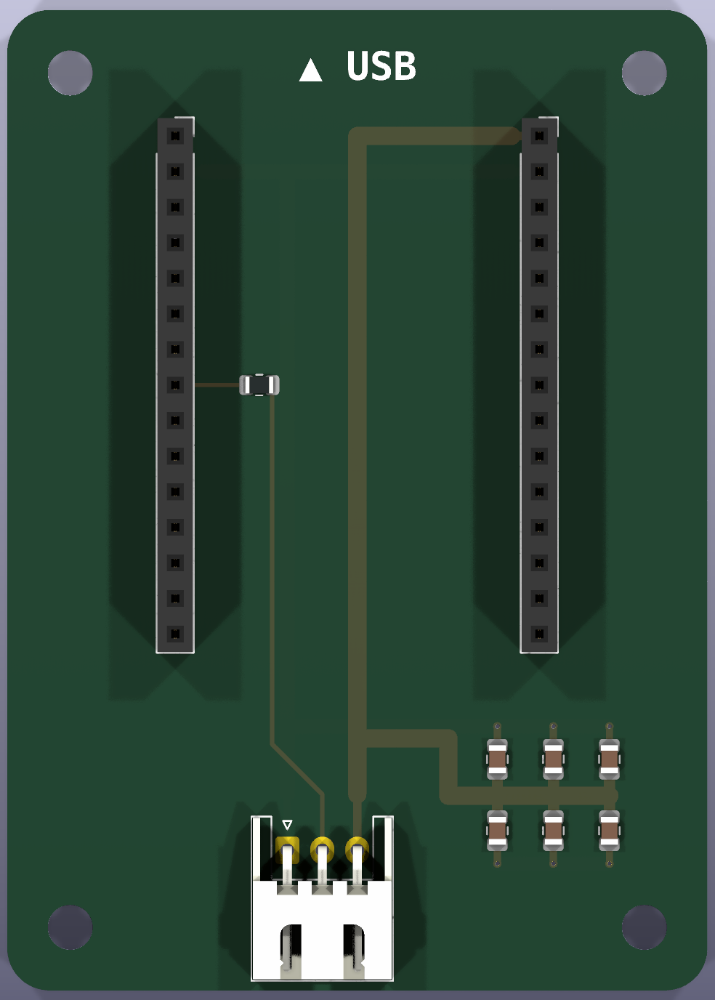
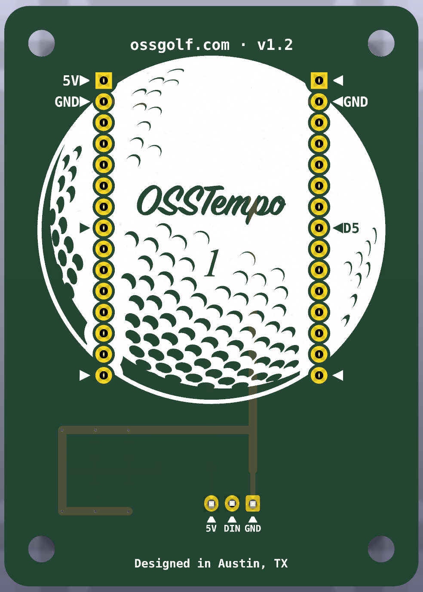
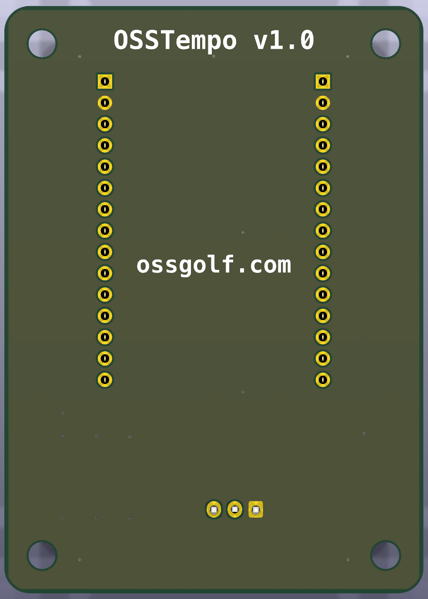

# osstempo PCB source

Board source for the ESP32 carrier PCB described in [`../pcb_build_spec.md`](../pcb_build_spec.md).
**That spec is the authority** on what the board is; this directory is how it gets built.

## What it looks like (v1.2)

| Front - component side | Back - the side you solder |
|---|---|
|  |  |

The ESP32 dev board plugs into the two sockets on the front, USB toward the `▲ USB` mark, and
JLCPCB places the resistor and the six 22 µF caps. The back is the hand-soldering side: an
arrow marks each of the eleven pins to solder (the four that carry a net, four more at the
socket ends for strength, the three LED-connector pins), every used pin is labelled, and the
rest is a 42 mm golf ball with the logo. The socket pads are 2.0 mm round, a 0.5 mm annular
ring, so there is copper to rest the iron on:


### Why the back has no copper plane: v1.0 vs v1.2

| v1.0 back | v1.2 back |
|---|---|
|  |  |

v1.0 had a solid ground plane on the back (the olive tint) and a ground pour on the front,
tied solid to the ground pins. In practice no socket pad would heat enough for solder to wet
it at 350-420 °C; the joints only took with a heat gun on the whole board. v1.1 removed every
pour, so each through-hole pin touches at most one trace; v1.2 adds the solder-side
silkscreen, the 2.0 mm pads, and drops every designator.

Renders come from `sh pcb/render.sh` (current release) or
`sh pcb/render.sh <file.kicad_pcb> <label>` (any revision, e.g. the v1.0 archive).

## The toolkit is a private dependency, not part of this repo

The board is authored with the
[kicad-agent-toolkit](https://github.com/georgemclaughlin/kicad-agent-toolkit) — a
**private, separately-licensed repo** checked out at `../../kicad-agent-toolkit`. Nothing
from it is vendored here: no source, no config, no example boards. `pcb/.ci/toolchain.json`
(its version-pin file) is gitignored and copied in by `setup-toolkit.sh`. If you don't have
access to the toolkit you can still open `routed/<board>/` in KiCad and send
`routed/<board>/` gerbers to a fab; you just can't regenerate from the YAML.

The toolkit only discovers boards under its own `examples/`, but `KICAD_AGENT_PROJECT_ROOT`
repoints it at an arbitrary board root — which is what `env.sh` does. An out-of-tree root
reproduces byte-identical results to running inside the toolkit repo.

### Toolkit branch `osstempo-patches-v2`

The board builds on a local branch of the toolkit clone: upstream `main` (fetched 2026-11-03)
plus the patches this board needs, each with tests and a docs page (`setup-toolkit.sh`
checks it out). They are general and belong upstream as PRs:

1. **Fill zones when autoroute is disabled.** With `autoroute.enabled: false` (the only
   option on macOS, below) the pipeline returned before any zone fill, so the saved board -
   and the gerbers - had zone outlines with no ground plane. Moot for v1.2 (no zones), still
   true upstream.
2. **`board.artwork`** - place a pad-less silkscreen footprint (the golf ball) without a
   reference label. Upstream's own `board.silkscreen_artwork` wants polygons inline in the
   manifest; a 143-outline TrueType rendering belongs in a footprint file.
3. **`mounting_holes[].hide_reference`** - drop the `MHn` labels.
4. **`pcb_no_reference_label`** on a component: no designator on the board at all. The
   toolkit draws its own `Cn`/`Rn`/`Hn` silkscreen label for every placed part
   (`pcb_hide_reference` only hides the footprint's built-in one, and the toolkit's tests rely
   on that meaning). A branded board with machine-placed passives wants neither - JLC places
   from the CPL, not the silkscreen.
5. **`board.zones[].pad_connection`** - thermal reliefs (`thru_hole_only`) for any future
   board that keeps a pour and still hand-solders its through-hole pins.
6. **`tht_hand_solder_heat`** layout-quality check - the hand-soldering heat model
   (`docs/framework/evidence/hand-solder-heat.md` in the toolkit). Declared in this board's
   `layout/osstempo_led_carrier_layout_quality.yaml`.

Retired: the `outline.corner_radius` patch. Upstream has `corner_radius_mm` since October;
it draws each corner as eight short edge segments where the patch drew one true arc, which is
the only difference between the ordered v1.2 gerbers and a rebuild on this branch.

The previous branch `osstempo-patches` (September upstream base) built the ordered v1.0 to
v1.2 releases and has been deleted; the zip committed in `build/jlcpcb_order/` is the one
uploaded to JLCPCB, and a rebuild on this branch reproduces it except for the Edge_Cuts
corners (`build.sh` rewrites the zip, so restore it from git after a rebuild unless the board
changed). Upstream moved under it in ways this board had to follow: the board source must record
[design-consideration decisions](examples/osstempo_led_carrier/osstempo_led_carrier_design_considerations.yaml),
every passive needs sourced nominal facts and ratings bound to a retained, hash-bound
datasheet under `vendor_ecad/datasheets/`, and rule-pack passive checks name a `part` kind
instead of a symbol. The `board considerations` report command still expects the toolkit's
block catalogue under the board root and does not run out-of-tree; validation does.

## Layout

```
pcb/
  env.sh                     source this first
  setup-toolkit.sh           one-time: toolkit branch, venv, ngspice, podman, KiBot image
  build.sh                   the build: validate x2, reseed, JLC order; stops the podman VM on exit
  reseed-routed.sh           copy the promoted release into routed/ and re-run DRC
  render.sh                  3D renders of routed/ (or any .kicad_pcb) -> renders/
  routed/<board>/            the accepted release, writable - what you OPEN and what goes to fab
  renders/                   the README images: v1.0 and v1.2 both sides, socket-pad close-up
  examples/<board>/          board source: manifest, artwork/, component usage/knowledge, emc/,
                             layout/, spice/
  component_packs/           our exact-part records (LCSC ids, footprint/model digests) + rule pack
  vendor_ecad/               only the official KiCad symbols/footprints/3D models the board uses,
                             plus our generated footprints; provenance in each README
  vendor_ecad/datasheets/    retained, hash-bound datasheets the component packs cite
  tools/make_logo_footprint.py    silkscreen artwork (spec JSON + fonts) -> polygon footprint
  tools/make_socket_footprint.py  official 15-way socket -> the 2.0 mm-pad copy for hand soldering
  tools/make_jlc_order.py         promoted release -> the JLCPCB upload set (zip + BOM + CPL)
  bin/podman                 shim: forces --platform linux/amd64 for the KiBot image
  design_blocks/             unused (authored-copper board needs none)
  .ci/toolchain.json         toolkit's version pins - gitignored, copied by setup
  build/jlcpcb_order/        the JLCPCB upload set for the current revision - committed
  build/v1.N-archive/        earlier revisions' order sets (v1.0 also keeps its routed board)
  build/kicad-agent/         the toolkit's run/release trees - gitignored, 300+ MB, regenerated
```

## Usage

```sh
sh pcb/setup-toolkit.sh                       # once
sh pcb/build.sh                               # the whole build; stops the podman VM when it exits
```

`build.sh` runs `board validate` twice (the second identical run promotes the release),
reseeds `routed/`, writes the JLCPCB order set, and **always stops the Podman VM** on exit -
the KiBot container needs the VM, but idle it pins 2 CPU cores and 4 GB of RAM. Run the
steps by hand only when debugging one of them:

```sh
source pcb/env.sh
$KICAD_AGENT board validate osstempo_led_carrier   # build + ERC/DRC + every evidence gate
$KICAD_AGENT board validate osstempo_led_carrier   # second matching run promotes the release
sh pcb/reseed-routed.sh osstempo_led_carrier  # sync build/.../current -> routed/, DRC
podman machine stop                           # build.sh does this for you
```

### Ordering from JLCPCB

```sh
python3 pcb/tools/make_jlc_order.py           # -> pcb/build/jlcpcb_order/
```

Turns the promoted release into the three things jlcpcb.com asks for: a gerber+drill zip, a
BOM CSV keyed by LCSC part number, and a CPL in JLC's column/units convention. It checks every
release file against `fabrication_manifest.json` first, and the zip is byte-reproducible.

Which parts JLC places is read off the board, not listed in the script: a footprint is an
assembly part **iff it has a `JLCPCB Part #` property**, so the hand-soldered H1/H2/J1 drop out
of both CSVs on their own.

It also makes the package uploadable, so **never send the release's gerbers to JLCPCB
directly** - its parser stalls at ~96% on them. Two things are wrong and both needed fixing:

1. The reproducibility pass normalises every `CreationDate` to the literal string `<normalized>`
   in the *shipped artifacts*, not just in the hash input, leaving an invalid X2 header. This
   belongs upstream as a PR alongside the `osstempo-patches-v2` patches: normalise for hashing,
   emit a real date.
2. JLCPCB does not digest the X2 attributes or the `.gbrjob` at all, so the script strips both by
   default (gerbers only - the drill's X2 comments carry the NPTH marking). `--x2` keeps them. The quote-page and assembly settings are tabulated in
[`../pcb_build_spec.md`](../pcb_build_spec.md) under "JLCPCB order notes".

Copper is authored in the manifest (`board.routes`, `board.vias`, `board.ground_stitching`,
`board.zones`), so the whole board regenerates from YAML. **Never edit generated `.kicad_*`
files** — change the YAML and re-validate. Two consecutive validate runs with identical
inputs promote an immutable release under `build/kicad-agent/<board>/current/`; its
`fabrication/` directory is the JLCPCB package.

**Never open KiCad on anything under `build/`.** Run and release trees are sealed; the
`.lck` files KiCad drops beside a project void a promotion mid-flight. Open `routed/<board>/`.

## macOS caveats (KiCad 10.0.6, established empirically)

- **`kicad-agent doctor` reports BLOCKED — ignore it.** It wants the exact versions in
  `.ci/toolchain.json` by string equality. It does not gate `board build`/`validate`.
- **Autorouting does not work on macOS** — the toolkit re-executes itself under KiCad's
  bundled Python, which is 3.9 here, and its parser uses 3.10 syntax (`DSN_EXPORT_FAILED`).
  Hence authored copper.
- **Fabrication export needs Podman** (Docker is rejected) and the pinned KiBot image is
  amd64-only; `bin/podman` adds `--platform linux/amd64`. First run pulls ~1 GB.
- `TMPDIR` must be symlink-free and outside the project root (`env.sh` resolves it).
